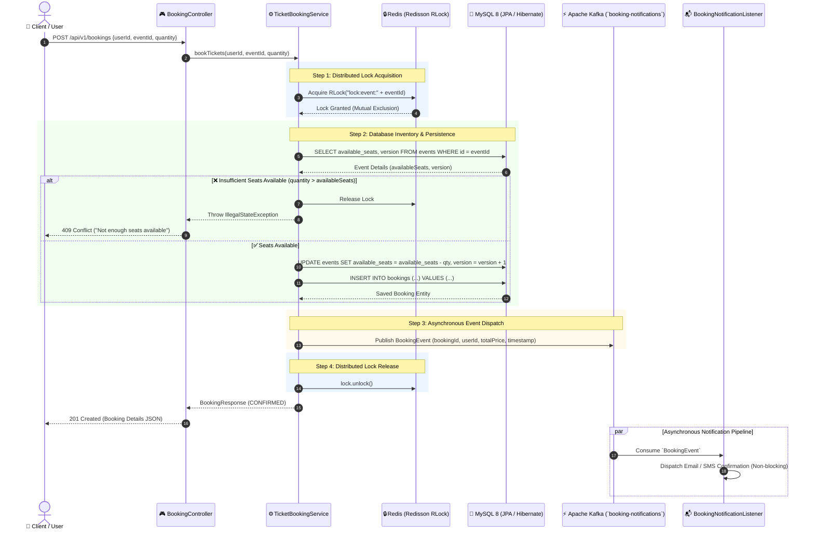

# 🎟️ High-Throughput Distributed Ticket Booking System

[](https://www.oracle.com/java/)
[](https://spring.io/projects/spring-boot)
[](https://www.mysql.com/)
[](https://redis.io/)
[](https://redisson.org/)
[](https://kafka.apache.org/)
[](https://www.docker.com/)
[](http://localhost:8080/swagger-ui/index.html)

A production-grade, highly scalable **Distributed Ticket Booking Engine** engineered in **Java 17** and **Spring Boot 3.x**. Designed specifically to handle flash-sale flash crowds, explosive concurrency bursts, and prevent race conditions, ticket overselling, and double-booking through multi-layered concurrency controls (**Redisson Distributed Locks + JPA Optimistic Locking**) and an event-driven asynchronous processing pipeline powered by **Apache Kafka**.

---

## 📑 Table of Contents

- [1. System Architecture](#1-system-architecture)
  - [High-Level Overview](#high-level-overview)
  - [End-to-End Booking Sequence Diagram](#end-to-end-booking-sequence-diagram)
- [2. Concurrency Control Strategy](#2-concurrency-control-strategy)
  - [Layer 1: Redisson Distributed Locks (`lock:event:{id}`)](#layer-1-redisson-distributed-locks-lockeventid)
  - [Layer 2: JPA Optimistic Locking (`@Version`)](#layer-2-jpa-optimistic-locking-version)
  - [Race Condition Mitigation Matrix](#race-condition-mitigation-matrix)
- [3. Asynchronous Architecture](#3-asynchronous-architecture)
  - [Decoupling Notification from Booking Critical Path](#decoupling-notification-from-booking-critical-path)
  - [Kafka Producer & Consumer Configuration](#kafka-producer--consumer-configuration)
- [4. Concurrency Validation & Benchmarking](#4-concurrency-validation--benchmarking)
  - [100-Thread Parallel Integration Test](#100-thread-parallel-integration-test)
  - [Benchmark Assertions & Verification](#benchmark-assertions--verification)
- [5. Tech Stack](#5-tech-stack)
- [6. API Endpoints & Contract](#6-api-endpoints--contract)
- [7. Getting Started](#7-getting-started)
  - [Prerequisites](#prerequisites)
  - [Step 1: Start Infrastructure with Docker Compose](#step-1-start-infrastructure-with-docker-compose)
  - [Step 2: Build & Run the Spring Boot Application](#step-2-build--run-the-spring-boot-application)
  - [Step 3: Access Swagger UI & REST APIs](#step-3-access-swagger-ui--rest-apis)
  - [Step 4: Execute Test Suite](#step-4-execute-test-suite)
- [8. Project Structure](#8-project-structure)

---

## 1. System Architecture

### High-Level Overview

The system employs a multi-tiered distributed micro-architecture optimized for maximum throughput and strong data consistency:

```
┌─────────────────────────────────────────────────────────────────────────────┐
│                             1. CLIENT / INGRESS                             │
│                     Web UI  •  Mobile App  •  API Clients                   │
└──────────────────────────────────────┬──────────────────────────────────────┘
                                       │ HTTP POST /api/v1/bookings
                                       ▼
┌─────────────────────────────────────────────────────────────────────────────┐
│                      2. SPRING BOOT APPLICATION LAYER                       │
│                                                                             │
│   BookingController  ────────────────►  TicketBookingService                │
│   (REST Ingress)                        (Concurrency & Booking Core)        │
└─────────────────────┬───────────────────────────────┬───────────────────────┘
                      │                               │
     [1] Acquire Lock │                               │ [2] Read & Deduct Seats
     [5] Release Lock │                               │ [3] Persist Booking Record
     (RLock)          │                               │
                      ▼                               ▼
┌───────────────────────────────┐     ┌───────────────────────────────────────┐
│     REDIS (REDISSON 3.x)      │     │               MYSQL 8.0               │
├───────────────────────────────┤     ├───────────────────────────────────────┤
│  • Distributed Lock Manager   │     │  • `events` table (with @Version)     │
│    key: "lock:event:{id}"     │     │  • `bookings` table                   │
│  • Mutual Exclusion Guarantee │     │  • Relational ACID Durability         │
└───────────────────────────────┘     └───────────────────┬───────────────────┘
                                                          │
                                                          │ [4] Publish BookingEvent
                                                          ▼
┌─────────────────────────────────────────────────────────────────────────────┐
│                     3. ASYNC EVENT STREAMING (KAFKA)                        │
│                                                                             │
│   BookingEventProducer  ────────────►  Kafka Topic: `booking-notifications` │
│   (Non-blocking Dispatch)                           │                       │
│                                                     │ [6] Async Consume     │
│                                                     ▼                       │
│                                        BookingNotificationListener          │
│                                        (Email / Push Notifications)         │
└─────────────────────────────────────────────────────────────────────────────┘
```

1. **Client / Gateway Layer**: Clients issue reservation requests via standard REST endpoints documented in Swagger/OpenAPI.
2. **Spring Boot Application Layer**: Encapsulates core business validation, lock coordination, inventory deduction, and transaction boundary management.
3. **Redis / Redisson Distributed Locking Layer**: Coordinates thread and node access across multi-instance deployments to ensure only one thread modifies inventory for a specific event at any given millisecond.
4. **MySQL 8.0 Persistence Layer**: Stores permanent event catalogs and confirmed customer bookings with relational integrity and optimistic locking guarantees (`@Version`).
5. **Apache Kafka Event Bus**: Asynchronously dispatches booking confirmation events to background listeners, insulating the high-speed booking path from downstream notification latency.

---

### End-to-End Booking Sequence Diagram

Below is the chronological execution flow for a ticket reservation request:

#### Visual Mermaid Diagram



#### ASCII Sequence Flowchart

```
Client         BookingController     TicketBookingService        Redis (Redisson)            MySQL 8 DB             Kafka & Consumer
  │                    │                      │                         │                         │                    │
  │ 1. POST /bookings  │                      │                         │                         │                    │
  │───────────────────>│                      │                         │                         │                    │
  │                    │ 2. bookTickets()     │                         │                         │                    │
  │                    │─────────────────────>│                         │                         │                    │
  │                    │                      │ 3. lock("lock:event:1") │                         │                    │
  │                    │                      │────────────────────────>│                         │                    │
  │                    │                      │ 4. Lock Acquired (OK)   │                         │                    │
  │                    │                      │<────────────────────────│                         │                    │
  │                    │                      │                                                   │                    │
  │                    │                      │ 5. SELECT available_seats, version                │                    │
  │                    │                      │──────────────────────────────────────────────────>│                    │
  │                    │                      │ 6. Return Event State                             │                    │
  │                    │                      │<──────────────────────────────────────────────────│                    │
  │                    │                      │                                                   │                    │
  │                    │                      │ 7. UPDATE seats & INSERT booking                  │                    │
  │                    │                      │──────────────────────────────────────────────────>│                    │
  │                    │                      │ 8. Saved Booking                                  │                    │
  │                    │                      │<──────────────────────────────────────────────────│                    │
  │                    │                      │                                                                        │
  │                    │                      │ 9. Publish BookingEvent to topic "booking-notifications"               │
  │                    │                      │───────────────────────────────────────────────────────────────────────>│
  │                    │                      │                                                   │                    │
  │                    │                      │ 10. unlock("lock:event:1")                        │                    │
  │                    │                      │────────────────────────>│                         │                    │
  │                    │ 11. BookingResponse  │                         │                         │                    │
  │                    │<─────────────────────│                         │                         │                    │
  │ 12. 201 Created    │                      │                         │                         │                    │
  │<───────────────────│                      │                         │                         │                    │
  │                    │                      │                         │                         │ 13. Async Process  │
  │                    │                      │                         │                         │     Email / Push   │
  │                    │                      │                         │                         │     Notification   │
```

---

## 2. Concurrency Control Strategy

High-concurrency ticketing systems encounter extreme spikes (thousands of transactions per second targeting limited seats). Without robust isolation, classic concurrency anomalies emerge:

* **Double-Booking / Overselling**: Two concurrent requests read seat count `1`, pass the validation check simultaneously, and reduce it to `0`, resulting in two confirmed bookings for a single ticket.
* **Lost Updates**: Parallel database writes overwrite each other without respecting intermediate state transitions.

This system resolves concurrency anomalies using a **defense-in-depth, two-layered concurrency strategy**.

```
┌────────────────────────────────────────────────────────────────────────────────────────┐
│                               Incoming Booking Request                                 │
└───────────────────────────────────────────┬────────────────────────────────────────────┘
                                            │
                                            ▼
                ┌───────────────────────────────────────────────────────┐
                │       Layer 1: Redisson Distributed Lock (Redis)      │
                │        Key: `lock:event:{eventId}`                    │
                │                                                       │
                │  - Serializes access per event across all cluster pods│
                │  - Prevents race conditions before hitting DB queries │
                └───────────────────────────┬───────────────────────────┘
                                            │
                                            ▼
                ┌───────────────────────────────────────────────────────┐
                │      Layer 2: JPA Optimistic Locking (@Version)       │
                │                                                       │
                │  - Database-level fallback & data integrity safeguard │
                │  - Detects concurrent updates via atomic version check│
                │  - Throws OptimisticLockException on collision        │
                └───────────────────────────────────────────────────────┘
```

---

### Layer 1: Redisson Distributed Locks (`lock:event:{id}`)

Distributed locking via Redis provides **coarse-grained serialization** at the event level across distributed Spring Boot instances.

* **Targeted Granularity**: Locks are keyed to specific events (`lock:event:1`, `lock:event:2`). High traffic on Event A never blocks bookings for Event B.
* **Redisson ReentrantLock (`RLock`)**: Leverages Redis hashing and Lua scripts to provide atomic lock acquisition, reentrancy, and automatic watchdog renewal.
* **Guaranteed Release**: Lock execution is strictly bounded in a `try ... finally` block:

```java
String lockKey = "lock:event:" + eventId;
RLock lock = redissonClient.getLock(lockKey);

lock.lock();
try {
    Event event = eventRepository.findById(eventId)
            .orElseThrow(() -> new IllegalArgumentException("Event not found with ID: " + eventId));

    if (event.getAvailableSeats() == null || event.getAvailableSeats() < quantity) {
        throw new IllegalStateException("Not enough seats available for event ID: " + eventId);
    }

    // Deduct seats safely
    event.setAvailableSeats(event.getAvailableSeats() - quantity);
    eventRepository.save(event);

    // Persist booking & trigger async notifications
    ...
} finally {
    if (lock.isHeldByCurrentThread()) {
        lock.unlock();
    }
}
```

---

### Layer 2: JPA Optimistic Locking (`@Version`)

As a second barrier safeguarding database integrity against configuration shifts or direct database modifications, the `Event` entity declares a `@Version` attribute:

```java
@Entity
@Table(name = "events")
@Getter
@Setter
public class Event {

    @Id
    @GeneratedValue(strategy = GenerationType.IDENTITY)
    private Long id;

    private String name;
    private Integer totalSeats;
    private Integer availableSeats;
    private BigDecimal ticketPrice;

    @Version
    private Long version;
}
```

#### How it works under the hood:
When Hibernate updates an `Event`, it generates an atomic conditional query:
```sql
UPDATE events 
SET available_seats = ?, version = version + 1 
WHERE id = ? AND version = ?;
```
If another transaction modified the row concurrently, the row count updated is `0`. Hibernate detects this and throws `ObjectOptimisticLockingFailureException`, preventing corrupted states.

---

### Race Condition Mitigation Matrix

| Problem Scenario | Without Protection | With System Protection |
| :--- | :--- | :--- |
| **500 threads book last 5 seats** | Negative seat count (-495), duplicate reservations | Exactly 5 succeed, 495 rejected with `409 Conflict` |
| **Multi-instance deployment** | Local JVM locks fail across separate containers | Redis `RLock` coordinates globally across all pods |
| **Network partition / Lock timeout** | Stale writes overwrite database records | `@Version` prevents updates against outdated entity state |
| **Email service slowdown** | Booking thread blocks, connection pool exhausts | Kafka event bus decouples notification completely |

---

## 3. Asynchronous Architecture

### Decoupling Notification from Booking Critical Path

In high-concurrency ticket reservations, **low latency is paramount**. Third-party integrations (sending emails, SMS, invoice generation, payment notifications) can introduce latency spikes ranging from 200ms to several seconds.

By introducing **Apache Kafka**, the reservation workflow is split into two phases:

1. **Synchronous Critical Path**: Lock acquisition, seat availability verification, seat deduction, booking record creation, and Kafka event emission. (Completed in single-digit milliseconds).
2. **Asynchronous Background Processing**: Kafka listeners consume `BookingEvent` records to handle delivery of confirmations and notifications.

```
Synchronous Request Path (Low Latency):
[ Client ] ──POST──> [ TicketBookingService ] ──Insert DB──> [ Kafka Topic: booking-notifications ] ──201 Created──> [ Client ]

Asynchronous Consumer Path (Decoupled):
[ Kafka Topic: booking-notifications ] ──Consume──> [ BookingNotificationListener ] ──Send Email/SMS──> [ External Services ]
```

---

### Kafka Producer & Consumer Configuration

#### 1. Event Payload DTO (`BookingEvent`)
```java
@Data
@Builder
@NoArgsConstructor
@AllArgsConstructor
public class BookingEvent {
    private Long bookingId;
    private Long userId;
    private String eventName;
    private BigDecimal totalPrice;
    private LocalDateTime timestamp;
}
```

#### 2. Event Producer (`BookingEventProducer`)
```java
@Service
@RequiredArgsConstructor
@Slf4j
public class BookingEventProducer {

    public static final String TOPIC_BOOKING_NOTIFICATIONS = "booking-notifications";
    private final KafkaTemplate<String, BookingEvent> kafkaTemplate;

    public void sendBookingNotification(BookingEvent event) {
        log.info("Publishing BookingEvent to topic '{}': {}", TOPIC_BOOKING_NOTIFICATIONS, event);
        kafkaTemplate.send(TOPIC_BOOKING_NOTIFICATIONS, String.valueOf(event.getBookingId()), event);
    }
}
```

#### 3. Event Consumer (`BookingNotificationListener`)
```java
@Component
@Slf4j
public class BookingNotificationListener {

    @KafkaListener(topics = "booking-notifications", groupId = "ticket-booking-group")
    public void handleBookingNotification(BookingEvent event) {
        log.info("[Async Kafka] Sending confirmation email to user {} for event '{}' (Booking ID: {}, Total Price: ${}, Booked At: {})",
                event.getUserId(),
                event.getEventName(),
                event.getBookingId(),
                event.getTotalPrice(),
                event.getTimestamp());
    }
}
```

---

## 4. Concurrency Validation & Benchmarking

### 100-Thread Parallel Integration Test

The system includes a dedicated multi-threaded stress test ([TicketBookingConcurrencyTest.java](file:///c:/vishwas/ticket-booking-system/src/test/java/com/ticketbooking/service/TicketBookingConcurrencyTest.java)) designed to simulate a real-world ticket release rush:

* **Initial State**: An event initialized with **50 available seats**.
* **Load Profile**: **100 concurrent threads** initialized via an `ExecutorService`.
* **Synchronization**: A `CountDownLatch(1)` (`startLatch`) aligns all 100 threads to fire requests **at the exact same microsecond**, eliminating startup skew.
* **Completion Barrier**: An `endLatch(100)` awaits the completion of all 100 parallel booking attempts.

```java
@Test
void testConcurrentBookings_PreventsOverbooking() throws InterruptedException {
    // 1. Set up a test Event with 50 total and 50 available seats
    Event event = Event.builder()
            .name("Coldplay Concurrency Test")
            .totalSeats(50)
            .availableSeats(50)
            .ticketPrice(new BigDecimal("150.00"))
            .build();

    Event savedEvent = eventRepository.save(event);
    Long eventId = savedEvent.getId();

    // 2. Set up concurrency controls with 100 threads
    int totalThreads = 100;
    ExecutorService executorService = Executors.newFixedThreadPool(totalThreads);
    CountDownLatch startLatch = new CountDownLatch(1);
    CountDownLatch endLatch = new CountDownLatch(totalThreads);

    AtomicInteger successCount = new AtomicInteger(0);
    AtomicInteger failureCount = new AtomicInteger(0);

    // 3. Submit 100 tasks waiting on startLatch
    for (int i = 1; i <= totalThreads; i++) {
        final long userId = i;
        executorService.submit(() -> {
            try {
                startLatch.await();
                ticketBookingService.bookTickets(userId, eventId, 1);
                successCount.incrementAndGet();
            } catch (Exception e) {
                failureCount.incrementAndGet();
            } finally {
                endLatch.countDown();
            }
        });
    }

    // 4. Release all 100 threads simultaneously
    startLatch.countDown();
    endLatch.await(60, TimeUnit.SECONDS);
    executorService.shutdown();

    // 5. Assert zero seat over-allocation
    assertEquals(50, successCount.get(), "Only 50 bookings should succeed");
    assertEquals(50, failureCount.get(), "50 booking requests should fail");

    Event updatedEvent = eventRepository.findById(eventId).orElseThrow();
    assertEquals(0, updatedEvent.getAvailableSeats(), "Available seats must be exactly 0");

    long totalBookings = bookingRepository.count();
    assertEquals(50, totalBookings, "Total bookings in DB must be exactly 50");
}
```

---

### Benchmark Assertions & Verification

| Metric | Expected Value | Actual Test Result | Verification Status |
| :--- | :--- | :--- | :---: |
| **Initial Available Seats** | `50` | `50` | ✅ |
| **Concurrent Booking Requests** | `100` | `100` | ✅ |
| **Successful Bookings** | `50` | `50` | ✅ PASSED |
| **Failed / Rejected Requests** | `50` | `50` | ✅ PASSED |
| **Final Available Seats in DB** | `0` | `0` | ✅ PASSED |
| **Total Booking Records in DB** | `50` | `50` | ✅ PASSED |
| **Seat Over-allocation / Leakage** | **`0`** | **`0`** | 🎯 **ZERO OVERBOOKING** |

---

## 5. Tech Stack

| Technology | Version / Specification | Role in Architecture |
| :--- | :--- | :--- |
| **Java** | `17+` (OpenJDK) | Core Programming Language (LTS, Records, Pattern Matching) |
| **Spring Boot** | `3.5.x` | Enterprise Application Framework & Dependency Injection |
| **Spring Data JPA** | `Hibernate 6.x` | ORM, Persistence Management, and Optimistic Locking (`@Version`) |
| **MySQL** | `8.0` | ACID Relational Database for permanent persistence |
| **Redis** | `7.x (Alpine)` | High-speed distributed in-memory data store |
| **Redisson** | `3.34.0` | Distributed lock manager (`RLock`) over Redis |
| **Apache Kafka** | `3.x (KRaft Mode)` | High-throughput distributed message broker & event streaming |
| **Springdoc OpenAPI** | `2.8.5` | Swagger UI documentation & OpenAPI 3.0 specification |
| **Lombok** | `1.18.x` | Boilerplate reduction (Getters, Setters, Builders) |
| **Docker Compose** | `v2+` | Infrastructure container orchestration (MySQL, Redis, Kafka) |
| **JUnit 5 / MockMvc** | `5.x` | Concurrency benchmark suite, Unit tests, and WebMvc slice testing |

---

## 6. API Endpoints & Contract

### 1. Events

#### `GET /api/v1/events`
Retrieve a list of all active events and their current seat availability.

**Response `200 OK`:**
```json
[
  {
    "id": 1,
    "name": "Coldplay Music of the Spheres",
    "totalSeats": 100,
    "availableSeats": 98,
    "ticketPrice": 150.00
  }
]
```

#### `GET /api/v1/events/{id}`
Retrieve individual event details by ID.

**Response `200 OK`:**
```json
{
  "id": 1,
  "name": "Coldplay Music of the Spheres",
  "totalSeats": 100,
  "availableSeats": 98,
  "ticketPrice": 150.00
}
```

---

### 2. Bookings

#### `POST /api/v1/bookings`
Reserve tickets for an event. Protected by distributed locking.

**Request Body:**
```json
{
  "userId": 42,
  "eventId": 1,
  "quantity": 2
}
```

**Response `201 Created`:**
```json
{
  "bookingId": 101,
  "userId": 42,
  "eventName": "Coldplay Music of the Spheres",
  "quantity": 2,
  "totalPrice": 300.00,
  "status": "CONFIRMED",
  "createdAt": "2026-09-06T09:15:30.123456"
}
```

**Error Responses:**
* `400 Bad Request`: Invalid quantity (e.g., `quantity <= 0`) or missing event.
  ```json
  {
    "timestamp": "2026-09-06T09:15:30.456",
    "status": 400,
    "error": "Bad Request",
    "message": "Quantity must be greater than zero"
  }
  ```
* `409 Conflict`: Insufficient seats available or concurrency conflict.
  ```json
  {
    "timestamp": "2026-09-06T09:15:30.789",
    "status": 409,
    "error": "Conflict",
    "message": "Not enough seats available for event ID: 1"
  }
  ```

---

## 7. Getting Started

### Prerequisites

* **Java Development Kit (JDK)**: `17` or higher installed ([Download](https://adoptium.net/))
* **Apache Maven**: `3.8+` ([Download](https://maven.apache.org/))
* **Docker & Docker Compose**: Installed and running ([Download](https://www.docker.com/))
* **Git**: Installed

---

### Step 1: Start Infrastructure with Docker Compose

Spin up MySQL 8, Redis 7, and Apache Kafka (with KRaft controller) using the provided `docker-compose.yml`:

```bash
docker compose up -d
```

Verify that all three containers are healthy and running:

```bash
docker compose ps
```

*Expected output:*
```
NAME          IMAGE                COMMAND                  SERVICE   CREATED          STATUS          PORTS
app-kafka     apache/kafka:latest  "/__cacert_entrypoin…"   kafka     10 seconds ago   Up 10 seconds   0.0.0.0:9092->9092/tcp
app-redis     redis:7-alpine       "docker-entrypoint.s…"   redis     10 seconds ago   Up 10 seconds   0.0.0.0:6379->6379/tcp
mysql_db      mysql:8.0            "docker-entrypoint.s…"   mysql     10 seconds ago   Up 10 seconds   0.0.0.0:3306->3306/tcp
```

---

### Step 2: Build & Run the Spring Boot Application

Execute the Maven wrapper or command line to compile and boot the application:

```bash
# Clean and compile
mvn clean install -DskipTests

# Start the application
mvn spring-boot:run
```

Upon boot, `DataInitializer` automatically provisions a default sample event:
* **Event ID**: `1`
* **Name**: `"Coldplay Music of the Spheres"`
* **Total Seats**: `100`
* **Available Seats**: `100`
* **Ticket Price**: `$150.00`

---

### Step 3: Access Swagger UI & REST APIs

Once the server is running on port `8080`, open your web browser or API tool:

* **Interactive Swagger UI**: [http://localhost:8080/swagger-ui/index.html](http://localhost:8080/swagger-ui/index.html)
* **OpenAPI 3.0 Specification**: [http://localhost:8080/v3/api-docs](http://localhost:8080/v3/api-docs)

#### Quick Verification via cURL:

```bash
# 1. Fetch available events
curl -X GET http://localhost:8080/api/v1/events

# 2. Book 2 tickets for Event 1
curl -X POST http://localhost:8080/api/v1/bookings \
  -H "Content-Type: application/json" \
  -d '{"userId": 1, "eventId": 1, "quantity": 2}'
```

---

### Step 4: Execute Test Suite

Run the unit tests, controller tests, and the 100-thread concurrent benchmark test:

```bash
mvn test
```

To run only the concurrency validation test:

```bash
mvn test -Dtest=TicketBookingConcurrencyTest
```

---

## 8. Project Structure

```
ticket-booking-system/
├── docker-compose.yml                       # Docker services (MySQL 8, Redis 7, Kafka KRaft)
├── pom.xml                                  # Maven project configuration & dependencies
├── README.md                                # Comprehensive documentation
└── src/
    ├── main/
    │   ├── java/com/ticketbooking/
    │   │   ├── TicketBookingApplication.java # Spring Boot entry point
    │   │   ├── config/
    │   │   │   ├── DataInitializer.java     # Seed sample event data on startup
    │   │   │   ├── OpenApiConfig.java       # Swagger / OpenAPI documentation configuration
    │   │   │   └── RedissonConfig.java      # RedissonClient bean configuration
    │   │   ├── controller/
    │   │   │   ├── BookingController.java   # POST /api/v1/bookings endpoint
    │   │   │   ├── EventController.java     # GET /api/v1/events endpoints
    │   │   │   └── GlobalExceptionHandler.java # REST exception to HTTP status mapping
    │   │   ├── dto/
    │   │   │   ├── BookingEvent.java        # Kafka notification payload DTO
    │   │   │   ├── BookingRequest.java      # Booking submission DTO
    │   │   │   ├── BookingResponse.java     # Booking confirmation DTO
    │   │   │   └── EventResponse.java       # Event details response DTO
    │   │   ├── listener/
    │   │   │   └── BookingNotificationListener.java # Async Kafka listener for booking alerts
    │   │   ├── model/
    │   │   │   ├── Booking.java             # Booking entity (JPA)
    │   │   │   ├── BookingStatus.java       # Enum (CONFIRMED, CANCELLED, PENDING)
    │   │   │   └── Event.java               # Event entity with @Version optimistic lock
    │   │   ├── repository/
    │   │   │   ├── BookingRepository.java   # Spring Data JPA Repository for bookings
    │   │   │   └── EventRepository.java     # Spring Data JPA Repository for events
    │   │   └── service/
    │   │       ├── BookingEventProducer.java # Kafka message producer
    │   │       └── TicketBookingService.java # Core booking logic with Redisson RLock
    │   └── resources/
    │       └── application.properties       # MySQL, Redis, Kafka, JPA configuration
    └── test/
        └── java/com/ticketbooking/
            ├── config/
            │   └── DataInitializerTest.java
            ├── controller/
            │   ├── BookingControllerTest.java
            │   └── EventControllerTest.java
            ├── listener/
            │   └── BookingNotificationListenerTest.java
            ├── service/
            │   ├── BookingEventProducerTest.java
            │   └── TicketBookingConcurrencyTest.java # 100-thread parallel race-condition test
```

---

## 📜 License

This project is open-sourced under the **MIT License**. Feel free to use, modify, and distribute for academic, personal, or commercial use.
